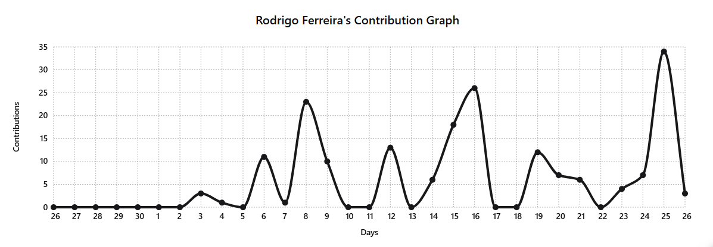
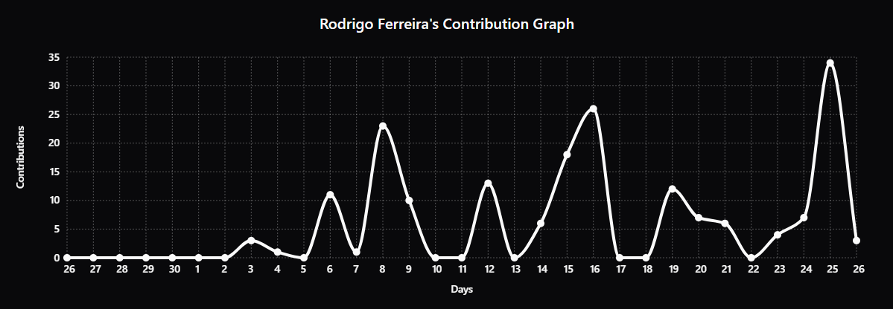
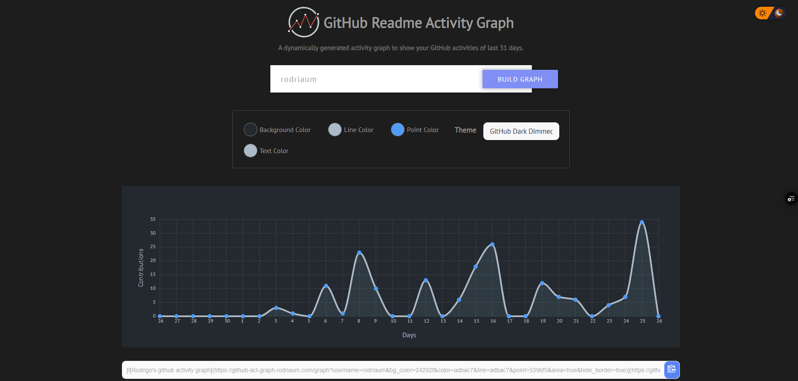

<p align="center">
    
</p>

<h1 align="center">Github Readme Activity Graph</h1>

<a href="https://jb.gg/OpenSourceSupport">
<p align="center">
    
</p>
</a>
<h3 align="center"><a href="https://jb.gg/OpenSourceSupport">Supported by JetBrains</a></h3>
A dynamically generated activity graph to show your GitHub activities of last 31 days.

### DEPLOYMENT

The deployment is `github-act-graph.rodriaum.com`.

Please refer to the updated link [here](#how-to-use)

## Table of contents

- [Table of contents](#table-of-contents)
- [How to Use](#how-to-use)
    - [Attention ⚠](#attention-)
    - [Organization Activity Graph](#organization-activity-graph)
    - [Optional Private Activity](#optional-private-activity)
- [Use themes](#use-themes)
- [Available Themes](#available-themes)
- [Customization](#customization)
    - [Common Options](#common-options)
- [Deploy on your own Vercel instance](#deploy-on-your-own-vercel-instance)
- [Contributing](#contributing)
- [Core Team 💻](#core-team-)
- [Contributors ✨](#contributors-)
- [Resources Used to build this project](#resources-used-to-build-this-project)
- [Star History](#star-history)
    - [Made with ❤ and TypeScript ](#made-with--and-typescript-)

## How to Use

Just paste the following URL in your profile readme and you are good to go.

**Pass your `username` in the URL**

```md
[](https://github.com/rodriaum/github-readme-activity-graph)
```

### [Attention ⚠](#deploy-on-your-own-vercel-instance)

### Organization Activity Graph

You can also generate an activity graph for a GitHub organization. Use the `organization` parameter with the organization's GitHub login:

```md
[](https://github.com/StudioLoad)
```

The organization graph counts commits across the organization's **public repositories only**. It does not include private repositories and does not require access to them. Anyone can embed the graph in a README by replacing `StudioLoad` with the organization's login.

You can use the existing graph customization parameters, such as `theme`, `days`, and `custom_title`, with the `organization` parameter as well.

## Optional Private Activity

Public activity is displayed by default without requiring users to log in.

To include private contributions, users must first enable **Show private contributions on my profile** in their GitHub settings:

1. Open **GitHub → Settings → Profile**.
2. Scroll down to **Contributions & activity**.
3. Enable **Show private contributions on my profile**.

This allows private contributions to appear in the user's profile contribution graph as aggregated counts, without revealing private repository names or details.

## Use themes

_`username=rodriaum&theme=theme_name`_

```md
[](https://github.com/rodriaum/github-readme-activity-graph)
```

[Manual Customization](#customization) is also available

## Available Themes

|            Name            |                            Preview                             |
| :------------------------: | :------------------------------------------------------------: |
| **Default (cotton candy)** |         |
|         **react**          |           |
|       **react-dark**       |      |
|         **github**         |          |
|      **shadcn-white**      |    |
|       **shadcn-dark**      |     |
|     **github-compact**     |  |
|         **xcode**          |           |
|         **rogue**          |           |
|         **merko**          |           |
|          **vue**           |             |
|      **tokyo-night**       |     |
|     **high-contrast**      |   |

For more themes click [here](https://github.com/rodriaum/github-readme-activity-graph/blob/main/THEMES.md)

## Customization

Personalize your GitHub activity graph using the [online customizer](https://github-act-graph.rodriaum.com/). Adjust its appearance and generate a graph URL ready to use in your profile README.



You can also configure the graph manually using URL parameters. The `type` parameter changes the graph design while preserving the selected theme and its colors. The default is `default`, which keeps the existing graph. Set `type=cartoon` for the rounded, playful design, `type=bar` for vertical bars, or `type=mountain` for a filled area chart.

```md
[](https://github.com/rodriaum/github-readme-activity-graph)
```

#### Common Options

|   Arguments    |                  Description                  |                 Type of Value                  |
| :------------: | :-------------------------------------------: | :--------------------------------------------: |
|   `bg_color`   |            card's background color            |             hex code (without `#`)             |
| `border_color` |              card's border color              |             hex code (without `#`)             |
|    `color`     |            graph card's text color            |             hex code (without `#`)             |
| `title_color`  |           graph card's title color            |             hex code (without `#`)             |
|     `line`     |              graph's line color               |             hex code (without `#`)             |
|    `point`     |         color of points on line graph         |             hex code (without `#`)             |
|  `area_color`  |       color of the area under the graph       |             hex code (without `#`)             |
|     `area`     |          shows area under the graph           |           boolean (default: `false`)           |
| `hide_border`  |   makes the border of the graph transparent   |           boolean (default: `false`)           |
|  `hide_title`  |       sets the title to an empty string       |           boolean (default: `false`)           |
| `custom_title` |          set the title to any string          |                     string                     |
|    `theme`     | name of [available themes](#available-themes) |                     string                     |
|    `radius`    |            border radius of graph             |            number (0-16 inclusive)             |
|    `height`    |              height of the graph              |           number (200-600 inclusive)           |
|     `days`     |      number of to days display on graph       | number between (1 - 90) [Recommended below 40] |
|     `from`     |       date from which the graph starts        |              format `YYYY-MM-DD`               |
|      `to`      |         date where the graph will end         |              format `YYYY-MM-DD`               |
|     `type`     | graph design: `default`, `cartoon`, `bar` or `mountain` | string |
|     `grid`     |                   show grid                   |           boolean (default: `true`)            |

⚠ **For `custom_title` please make sure that you are using %20 for spaces**

Example:

**`custom_title=This%20is%20a%20title`**

```md
[](https://github.com/rodriaum/github-readme-activity-graph)
```

**Example:**

```md
[](https://github.com/rodriaum/github-readme-activity-graph)
```

## Deploy on your own Vercel instance

You can deploy your own instance using the button below or by importing this repository from your [Vercel dashboard](https://vercel.com/dashboard).

[](https://vercel.com/import/project?template=https://github.com/rodriaum/github-readme-activity-graph)

Configure the `TOKEN` environment variable in **Vercel → Settings → Environment Variables** with a GitHub Personal Access Token. This is required for the graph to retrieve GitHub activity. After adding the variable, redeploy the project. Then use your Vercel domain:

```md

```

## Contributing

Please read through our [contributing guidelines](https://github.com/rodriaum/github-readme-activity-graph/blob/main/CONTRIBUTING.md). Directions are included for opening issues, coding standards, and notes on development.

## Core Team 💻

<table>
    <tr>
        <td align="center">
        <a href="http://github.com/Ashutosh00710">
            
            <br />
            <sub><b>Ashutosh Dwivedi</b></sub>
        </a>
        <br />
        <a href="#projectManagement" title="Project Management">📆</a>
        <a href="https://github.com/rodriaum/github-readme-activity-graph/commits?author=ashutosh00710" title="Code">💻</a>
        <a href="#documentation" title="Documentation">📖</a>
        <a href="#ideas" title="Ideas & Planning">🤔</a>
        <a href="#testing" title="Testing">⚠</a>
    </td>
    <td align="center">
        <a href="http://github.com/kshitij978">
            
            <br />
            <sub><b>Kshitij Srivastava</b></sub>
        </a>
        <br />
        <a href="#projectManagement" title="Project Management">📆</a>
        <a href="https://github.com/rodriaum/github-readme-activity-graph/commits?author=kshitij978" title="Code">💻</a>
        <a href="#documentation" title="Documentation">📖</a>
        <a href="#design" title="Design">🎨</a>
    </td>
    </tr>
</table>

## Contributors ✨

Thanks goes to these wonderful people ([emoji key](https://allcontributors.org/docs/en/emoji-key)):

<!-- ALL-CONTRIBUTORS-LIST:START - Do not remove or modify this section -->
<!-- prettier-ignore-start -->
<!-- markdownlint-disable -->
<table>
  <tr>
    <td align="center">
        <a href="https://github.com/tintindas">
            
            <br />
            <sub><b>Upamanyu Das</b></sub>
        </a>
        <br />
        <a href="https://github.com/rodriaum/github-readme-activity-graph/commits?author=tintindas" title="Documentation">📖</a>
    </td>
    <td align="center">
        <a href="https://github.com/DenverCoder1">
            
            <br />
            <sub><b>Jonah Lawrence</b></sub>
        </a>
        <br />
        <a href="https://github.com/rodriaum/github-readme-activity-graph/commits?author=DenverCoder1" title="Code">💻</a>
        <a href="https://github.com/rodriaum/github-readme-activity-graph/commits?author=DenverCoder1" title="Documentation">📖</a>
    </td>
    <td align="center">
        <a href="https://github.com/MilindModi">
            
            <br />
            <sub><b>Milind Modi</b></sub>
        </a>
        <br />
        <a href="https://github.com/rodriaum/github-readme-activity-graph/commits?author=MilindModi" title="Documentation">📖</a>
    </td>
    <td align="center">
        <a href="https://github.com/Vaibhav-afk">
            
            <br />
            <sub><b>Vaibhav</b></sub>
        </a>
        <br />
        <a href="https://github.com/rodriaum/github-readme-activity-graph/commits?author=Vaibhav-afk" title="Code">💻</a>
        <a href="https://github.com/rodriaum/github-readme-activity-graph/commits?author=Vaibhav-afk" title="Documentation">📖</a>
    </td>
    <td align="center">
        <a href="https://github.com/jgphilpott">
            
            <br />
            <sub><b>Jacob Philpott</b></sub>
        </a>
        <br />
        <a href="https://github.com/rodriaum/github-readme-activity-graph/commits?author=jgphilpott" title="Code">💻</a>
        <a href="https://github.com/rodriaum/github-readme-activity-graph/commits?author=jgphilpott" title="Documentation">📖</a>
    </td>
    <td align="center">
        <a href="https://github.com/SonuKumar81800">
            
            <br />
            <sub><b>Sonu Kumar</b></sub>
        </a>
        <br />
        <a href="https://github.com/rodriaum/github-readme-activity-graph/commits?author=SonuKumar81800" title="Style">🎨</a>
        <a href="https://github.com/rodriaum/github-readme-activity-graph/commits?author=SonuKumar81800" title="Documentation">📖</a>
    </td>
    <td align="center">
        <a href="https://github.com/andinoriel">
            
            <br />
            <sub><b>Mykola Symon</b></sub>
        </a>
        <br />
        <a href="https://github.com/rodriaum/github-readme-activity-graph/commits?author=andinoriel" title="Code">💻</a>
    </td>
  </tr>
  <tr>
    <td align="center">
        <a href="https://github.com/sreyan-ghosh">
            
            <br />
            <sub><b>Sreyan Ghosh</b></sub>
        </a>
        <br />
        <a href="https://github.com/rodriaum/github-readme-activity-graph/commits?author=sreyan-ghosh" title="Style">🎨</a>
    </td>
    <td align="center">
        <a href="https://github.com/Anant-mishra1729">
            
            <br />
            <sub><b>Anant Mishra</b></sub>
        </a>
        <br />
        <a href="https://github.com/rodriaum/github-readme-activity-graph/commits?author=Anant-mishra1729" title="Style">🎨</a>
    </td>
    <td align="center">
        <a href="https://github.com/SKewLinez">
            
            <br />
            <sub><b>Skyler</b></sub>
        </a>
        <br />
        <a href="https://github.com/rodriaum/github-readme-activity-graph/commits?author=SKewLinez" title="Style">🎨</a>
    </td>
    <td align="center">
        <a href="https://github.com/eliely">
            
            <br />
            <sub><b>Iryna Mykoliuk</b></sub>
        </a>
        <br />
        <a href="https://github.com/rodriaum/github-readme-activity-graph/commits?author=eliely" title="Style">🎨</a>
    </td>
    <td align="center">
        <a href="https://github.com/DalpatRathore">
            
            <br />
            <sub><b>Dalpat Rathore</b></sub>
        </a>
        <br />
        <a href="https://github.com/rodriaum/github-readme-activity-graph/commits?author=DalpatRathore" title="Style">🎨</a>
        <a href="https://github.com/rodriaum/github-readme-activity-graph/commits?author=DalpatRathore" title="Code">💻</a>
    </td>
    <td align="center">
        <a href="https://github.com/fishmandev">
            
            <br />
            <sub><b>Dmitriy Fishman</b></sub>
        </a>
        <br />
        <a href="https://github.com/rodriaum/github-readme-activity-graph/commits?author=fishmandev" title="Documentation">📖</a>
    </td>
    <td align="center">
        <a href="https://github.com/MagicLike">
            
            <br />
            <sub><b>MagicLike</b></sub>
        </a>
        <br />
        <a href="https://github.com/rodriaum/github-readme-activity-graph/commits?author=MagicLike" title="Style">🎨</a>
        <a href="https://github.com/rodriaum/github-readme-activity-graph/commits?author=MagicLike" title="Code">💻</a>
    </td>
  </tr>
  </tr>
    <td align="center">
        <a href="https://github.com/OnkarRuikar">
            
            <br />
            <sub><b>OnkarRuikar</b></sub>
        </a>
        <br />
        <a href="https://github.com/rodriaum/github-readme-activity-graph/commits?author=OnkarRuikar" title="Code">💻</a>
    </td>
    <td align="center">
        <a href="https://github.com/valetzx">
            
            <br />
            <sub><b>valetzx</b></sub>
        </a>
        <br />
        <a href="https://github.com/rodriaum/github-readme-activity-graph/commits?author=valetzx" title="Documentation">📖</a>
    </td>
    <td align="center">
        <a href="https://github.com/tranthaituananh">
            
            <br />
            <sub><b>tranthaituananh</b></sub>
        </a>
        <br />
        <a href="https://github.com/rodriaum/github-readme-activity-graph/commits?author=tranthaituananh" title="Style">🎨</a>
        <a href="https://github.com/rodriaum/github-readme-activity-graph/commits?author=tranthaituananh" title="Documentation">📖</a>
    </td>
    <td align="center">
        <a href="https://github.com/polekstulod">
            
            <br />
            <sub><b>polekstulod</b></sub>
        </a>
        <br />
        <a href="https://github.com/rodriaum/github-readme-activity-graph/commits?author=polekstulod" title="Documentation">📖</a>
    </td>
    <td align="center">
        <a href="https://github.com/jmloudis">
            
            <br />
            <sub><b>jmloudis</b></sub>
        </a>
        <br />
        <a href="https://github.com/rodriaum/github-readme-activity-graph/pulls?q=author%3Ajmloudis+" title="Code">💻</a>
    </td>
    <td align="center">
        <a href="https://github.com/fabianocouto">
            
            <br />
            <sub><b>fabianocouto</b></sub>
        </a>
        <br />
        <a href="https://github.com/rodriaum/github-readme-activity-graph/commits?author=fabianocouto" title="Code">💻</a>
        <a href="https://github.com/rodriaum/github-readme-activity-graph/commits?author=fabianocouto" title="Documentation">📖</a>
    </td>
    <td align="center">
        <a href="https://github.com/rodriaum">
            
            <br />
            <sub><b>rodriaum</b></sub>
        </a>
        <br />
        <a href="https://github.com/rodriaum/github-readme-activity-graph/commits?author=rodriaum" title="Code">💻</a>
        <a href="https://github.com/rodriaum/github-readme-activity-graph/commits?author=rodriaum" title="Documentation">📖</a>
    </td>
  </tr>
</table>

<!-- markdownlint-restore -->
<!-- prettier-ignore-end -->

<!-- ALL-CONTRIBUTORS-LIST:END -->

This project follows the [all-contributors](https://github.com/all-contributors/all-contributors) specification. Contributions of any kind welcome!

## Resources Used to build this project

|      Purpose       |  Library Name   |                   Link                    |
| :----------------: | :-------------: | :---------------------------------------: |
| Graph Construction | **CHARTIST.JS** | <https://github.com/gionkunz/chartist-js> |

</br>
<hr/>

## Star History

<table>
  <tr>
    <td>
      <a href="https://star-history.com/#Ashutosh00710/github-readme-activity-graph&Timeline">
        
      </a>
    </td>
    <td>
      <a href="https://star-history.com/#rodriaum/github-readme-activity-graph&Timeline">
        
      </a>
    </td>
  </tr>
</table>

### Made with ❤ and TypeScript 
