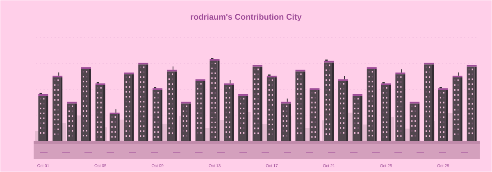

<p align="center">
    
</p>

<h1 align="center">GITHUB README ACTIVITY GRAPH</h1>

## Table of contents

- [Table of contents](#table-of-contents)
- [Fork Differences](#fork-differences)
    - [Deployment](#deployment)
- [How to Use](#how-to-use)
    - [Organization Activity Graph](#organization-activity-graph)
    - [Optional Private Activity](#optional-private-activity)
- [Use themes](#use-themes)
- [Available Themes](#available-themes)
- [Graph Types](#graph-types)
- [Customization](#customization)
    - [Common Options](#common-options)
- [Project Template](#project-template)
- [Contributing](#contributing)
- [License](#license)
- [Team](#core-team-)
- [Star History](#star-history)
    - [Made with ❤ and TypeScript ](#made-with--and-typescript-)

## Fork Differences

This project is a modernized fork of [github-readme-activity-graph](https://github.com/Ashutosh00710/github-readme-activity-graph), rebuilt from the ground up as **v2**.

While preserving the original concept and core functionality, this version introduces:

- **Modern Stack:** Migrated from Express to Next.js using recent versions of React and TypeScript.
- **Updated Chartist:** New rendering engine with improved SVG generation and handling.
- **SVG Security:** Fixes and improvements to prevent unsafe SVG injection.
- **Activity Graph Studio:** A web-based builder for visual customization, live previews and automatic Markdown generation.
- **Advanced Customization:** New graph styles, themes and additional visual options.
- **Improved API:** Better validation, error handling, caching and rate limiting.

The original project remains the foundation, while this fork follows an independent development direction with a modern architecture and expanded capabilities.

### Deployment

The project is deployed at `github-act-graph.rodriaum.com`

Visit the deployment using the link [here](https://github-act-graph.rodriaum.com).

## How to Use

Just paste the following URL in your profile readme and you are good to go.

**Pass your `username` in the URL**

```md
[](https://github.com/rodriaum/github-readme-activity-graph)
```

### Organization Activity Graph

> [!WARNING]
> Organization activity dates are no longer supported. As a result, the graph will be displayed without contribution data. This limitation exists because GitHub does not provide an efficient way to retrieve organization contribution activity.

You can also generate an activity graph for a GitHub organization. Use the `organization` parameter with the organization's GitHub login:

```md
[](https://github.com/StudioLoad)
```

The organization graph counts commits across the organization's **public repositories only**. It does not include private repositories and does not require access to them. Anyone can embed the graph in a README by replacing `StudioLoad` with the organization's login.

You can use the existing graph customization parameters, such as `theme`, `days`, and `custom_title`, with the `organization` parameter as well.

## Optional Private Activity

Public activity is displayed by default without requiring users to log in.

To include private contributions, users must first enable **Show private contributions on my profile** in their GitHub settings:

1. Open **GitHub → Settings → Profile**.
2. Scroll down to **Contributions & activity**.
3. Enable **Show private contributions on my profile**.

This allows private contributions to appear in the user's profile contribution graph as aggregated counts, without revealing private repository names or details.

## Use themes

_`username=rodriaum&theme=theme_name`_

```md
[](https://github.com/rodriaum/github-readme-activity-graph)
```

[Manual Customization](#customization) is also available

## Available Themes

|            Name            |                             Preview                             |
| :------------------------: |:---------------------------------------------------------------:|
| **Default (cotton candy)** |  |
|         **react**          |           |
|       **react-dark**       |      |
|         **github**         |          |
|     **github-compact**     |  |
|         **xcode**          |           |
|         **rogue**          |           |
|         **merko**          |           |
|          **vue**           |             |
|      **tokyo-night**       |     |
|       **monochrome**       |    |
|     **high-contrast**      |   |

For more themes click [here](https://github.com/rodriaum/github-readme-activity-graph/blob/main/THEMES.md)

## Graph Types

Choose the graph style independently from the theme.

```text
https://github-act-graph.rodriaum.com/graph?username=rodriaum&type=pixel-city&theme=github-dark
```

|            Type              |                             Preview                              |
| :--------------------------: |:----------------------------------------------------------------:|
|          **default**         |    |
|            **bar**           |        |
|            **neon**          |       |
|          **terminal**        |   |
|          **gradient**        |   |
|        **pixel-city**       |  |

## Customization

Personalize your GitHub activity graph using the [online customizer](https://github-act-graph.rodriaum.com/). Adjust its appearance and generate a graph URL ready to use in your profile README.


You can also configure the graph manually using URL parameters.

### Examples:

#### Minimal



```text
https://github-act-graph.rodriaum.com/graph?username=rodriaum&theme=shadcn-dark&type=default&area=false&grid=false&show_point=false&hide_y_axis=true&hide_border=true
```

#### Sparkline



```text
https://github-act-graph.rodriaum.com/graph?username=rodriaum&theme=github-dark&type=default&area=true&grid=false&show_point=false&hide_y_axis=false&hide_border=true
```

### Common Options

|   Arguments    |                  Description                  |                 Type of Value                  |
| :------------: | :-------------------------------------------: | :--------------------------------------------: |
|   `bg_color`   |            card's background color            |             hex code (without `#`)             |
| `border_color` |              card's border color              |             hex code (without `#`)             |
|    `color`     |            graph card's text color            |             hex code (without `#`)             |
| `title_color`  |           graph card's title color            |             hex code (without `#`)             |
|     `line`     |              graph's line color               |             hex code (without `#`)             |
|    `point`     |         color of points on line graph         |             hex code (without `#`)             |
|  `area_color`  |       color of the area under the graph       |             hex code (without `#`)             |
|     `area`     |          shows area under the graph           |           boolean (default: `false`)            |
| `hide_border`  |   makes the border of the graph transparent   |           boolean (default: `false`)            |
| `hide_title`   |       sets the title to an empty string       |           boolean (default: `false`)            |
| `hide_y_axis` | hides the contribution count labels on the vertical axis | boolean (default: `false`) |
| `custom_title` |          set the title to any string          |                     string                     |
|    `theme`     | name of [available themes](#available-themes) |                     string                     |
|    `radius`    |            border radius of graph             |            number (0-16 inclusive)             |
|    `height`    |              height of the graph              |           number (200-600 inclusive)            |
|    `days`      |      number of to days display on graph       | number between (1 - 90) [Recommended below 40] |
|    `from`      |       date from which the graph starts        |              format `YYYY-MM-DD`               |
|     `to`      |         date where the graph will end         |              format `YYYY-MM-DD`               |
|    `type`     | name of [graph types](#graph-types)           |                     string                     |
|    `grid`     |                   show grid                   |           boolean (default: `true`)             |
| `show_point` |             shows line chart points             |           boolean (default: `true`)             |

⚠ **For `custom_title` please make sure that you are using %20 for spaces**

## Project Template

This project is built using the [Next.js Template](https://github.com/SaturnixStudio/nextjs-template), developed by **Saturnix Studio**.

## Contributing

Please read through our [contributing guidelines](https://github.com/rodriaum/github-readme-activity-graph/blob/main/CONTRIBUTING.md). Directions are included for opening issues, coding standards, and notes on development.

## License

This project is licensed under the [MIT License](LICENSE).

## Team

<table>
    <tr>
        <td align="center">
        <a href="https://github.com/rodriaum">
            
            <br />
            <sub><b>rodriaum</b></sub>
        </a>
        <br />
        <a href="https://github.com/rodriaum/github-readme-activity-graph/commits?author=rodriaum" title="Commits">🚀</a>
    </td>
    </tr>
</table>

<!-- markdownlint-restore -->
<!-- prettier-ignore-end -->

## Star History

<table>
  <tr>
    <td>
      <a href="https://star-history.com/#rodriaum/github-readme-activity-graph&Timeline">
        
      </a>
    </td>
  </tr>
</table>

### Made with ❤ and Next.js 
